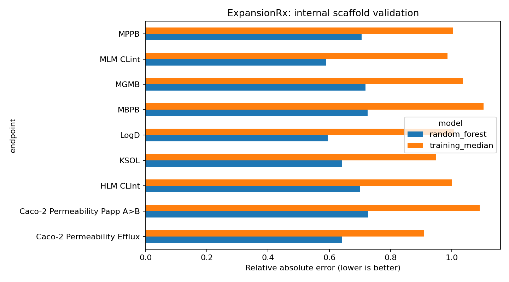

# First baseline verification

Run on 2026-11-10 using the default 200-tree configuration, seed 42, two CPU workers, Python 3.11.16 on macOS ARM64. This is a real run on all 5,326 original training molecules: 4,204 internal training rows and 1,122 scaffold-validation rows.

- Random forest macro RAE: **0.6713403**
- Training-median macro RAE: **1.0097769**
- Both are point estimates on one internal split; no confidence interval or competition placement is claimed.
- No published challenge test labels were downloaded.

`metrics.csv` contains the endpoint scores and label counts. `identity.json` records the exact source checksum, data checksum and primary package versions. `audit.json` records split and data checks. Numerical results can vary slightly across platforms.

